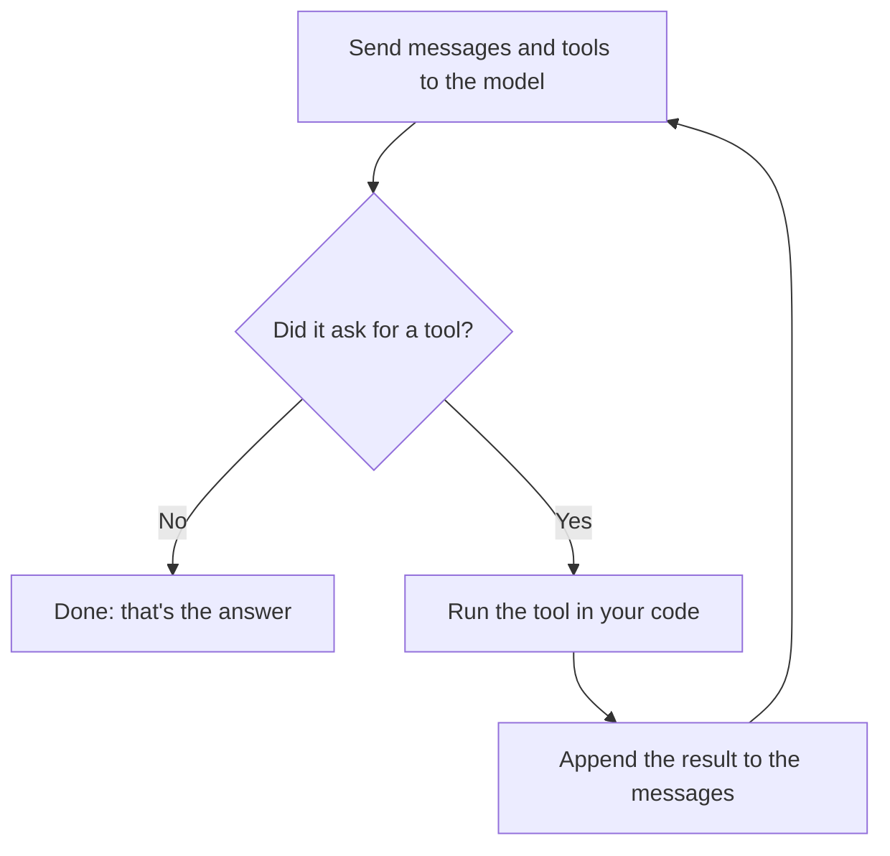

# Build Your Own Coding Agent

**Learn how tools like Claude Code and Cursor work by building one from scratch: one notebook, one feature at a time.**

No frameworks, no SDKs and no magic. You start with a single HTTP request, and every notebook adds one piece to the same agent.

[](https://github.com/umangbagadi03/build-your-own-coding-agent/actions/workflows/notebooks.yml)
[](https://colab.research.google.com/github/umangbagadi03/build-your-own-coding-agent/blob/main/notebooks/01_first_api_call.ipynb)
[](LICENSE)

## What you'll have after Part 1

An agent that finds and fixes real bugs on its own. Here it is in notebook 05, running on a small model on a laptop, with no cloud API involved:

```text
[1] list_files({})
    ["cart.py", "test_cart.py"]
[2] read_file({"path":"cart.py"})
    def subtotal(items):
[3] read_file({"path":"test_cart.py"})
    import unittest
[4] run_tests({})
    FAILED
[5] write_file({"content":"def subtotal(items):\n    \"\"\"Total price of a)
    Wrote 370 characters to cart.py
[6] run_tests({})
    PASSED
```

```diff
-    return sum(item["price"] for item in items)
+    return sum(item["price"] * item["quantity"] for item in items)

-    return 0 if total > 50 else 5
+    return 0 if total >= 50 else 5
```

*One real run on Gemma 4 E2B (3.6 GB, quantized) through Ollama. Results vary between runs and models.*

The agent is 34 lines of logic plus 31 lines of tools, not counting its prompt and tool descriptions. Notebook 05 measures this itself.

## The whole idea

An agent is a model call inside a loop. The model picks the next step, and your code carries it out.



Everything else in this course makes that loop safe, efficient and reliable.

## Course

### Part 1: The Loop (available now)

| # | Notebook | What you build | Run |
|---|---|---|---|
| 01 | [Your First LLM API Call](notebooks/01_first_api_call.ipynb) | A raw HTTP call, conversation memory, token accounting | [](https://colab.research.google.com/github/umangbagadi03/build-your-own-coding-agent/blob/main/notebooks/01_first_api_call.ipynb) |
| 02 | [Streaming](notebooks/02_streaming.ipynb) | Your own SSE parser, and measuring time to first token | [](https://colab.research.google.com/github/umangbagadi03/build-your-own-coding-agent/blob/main/notebooks/02_streaming.ipynb) |
| 03 | [Tool Calling](notebooks/03_tool_calling.ipynb) | The full tool round trip, and a dispatcher that survives bad model output | [](https://colab.research.google.com/github/umangbagadi03/build-your-own-coding-agent/blob/main/notebooks/03_tool_calling.ipynb) |
| 04 | [The Agent Loop](notebooks/04_agent_loop.ipynb) | The loop itself, why its cost grows so fast, and testing with fake models | [](https://colab.research.google.com/github/umangbagadi03/build-your-own-coding-agent/blob/main/notebooks/04_agent_loop.ipynb) |
| 05 | [Your First Real Agent](notebooks/05_first_real_agent.ipynb) | An agent that fixes real bugs, sandboxed file tools, independent verification | [](https://colab.research.google.com/github/umangbagadi03/build-your-own-coding-agent/blob/main/notebooks/05_first_real_agent.ipynb) |

### Coming next

| Part | Notebooks | Topics |
|---|---|---|
| 2. Tools | 06–10 | Precise file edits, a shell, permissions, a real sandbox |
| 3. Context | 11–15 | Token budgets, compaction, memory, code search |
| 4. Reliability | 16–20 | Evals, tracing, cost control, retries, caching |
| 5. Multi-agent | 21–25 | Subagents, MCP, skills, hooks |
| 6. Ship It | 26–30 | A real CLI, packaging, benchmarks on real bugs |

## Run it with no key

Every notebook runs **for free with no API key**. In offline mode the same HTTP code talks to a small local server that speaks the real wire format.

That server is a **script, not a model**. Its answers and token counts are canned, so it teaches you the mechanics but can't show you real intelligence. For that, plug in a real model. No code changes, just one setting:

| Provider | Set this | Status |
|---|---|---|
| Offline script | nothing | Tested on every push |
| [Ollama](https://ollama.com) (local) | `LLM_PROVIDER=ollama` | Part 1 tested on Gemma 4 E2B |
| [Groq](https://console.groq.com) (has a free tier) | `GROQ_API_KEY` | Not tested yet |
| OpenAI | `OPENAI_API_KEY` and `LLM_MODEL` | Not tested yet |
| Any OpenAI-compatible API | `LLM_PROVIDER=custom`, `LLM_BASE_URL`, `LLM_MODEL`, and optionally `LLM_API_KEY` | Not tested yet |

Models need tool-calling support for notebooks 03 to 05. On Colab, add keys under **Secrets**, not in a notebook cell, so they don't end up in a saved copy.

## Run it locally

```bash
git clone https://github.com/umangbagadi03/build-your-own-coding-agent.git
cd build-your-own-coding-agent
pip install -r requirements.txt
jupyter notebook notebooks/
```

Run every notebook as an end-to-end test:

```bash
python scripts/run_notebooks.py
```

## How this course is different

- **Nothing hidden.** You write the HTTP calls, the parser, the loop and the tools yourself, so no framework can hide how it works.
- **One agent all the way through.** The notebooks build toward one working agent rather than a pile of separate demos.
- **Tested.** CI runs every notebook from top to bottom on each push, and the cells include checkpoints that fail if the lesson breaks.
- **Honest about failure.** You'll build the fake models, safety checks and independent verification that show when an agent is wrong, including when it says it succeeded.

## Safety

A coding agent runs actions chosen by a model. Notebook 05 limits file access to a temporary folder and has no shell tool, but `run_tests` still executes code the model may have written, with your user permissions. **That isn't a true sandbox.** Run it on the sample project provided, or on Colab, and don't point it at anything you care about until Part 2.

## Contributing

Issues and pull requests are welcome, especially for mistakes, confusing explanations and results from models or providers not yet tested. See the [contribution guide](CONTRIBUTING.md) to get started.

## License

[MIT](LICENSE)
