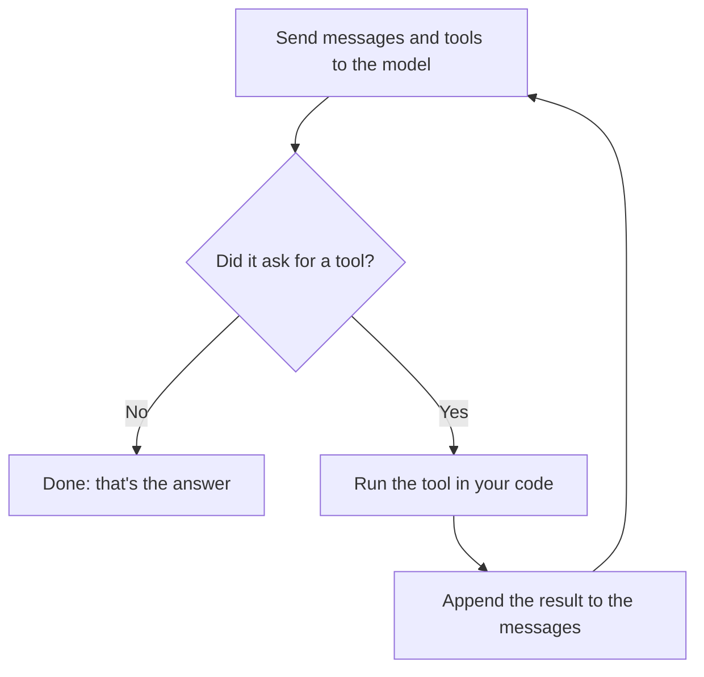

# Build Your Own Coding Agent

**Learn how tools like Claude Code and Cursor work by building one from scratch: one notebook, one feature at a time.**

No frameworks, no SDKs and no magic. You start with a single HTTP request, and every notebook adds one piece to the same agent.

[](https://github.com/umangbagadi03/build-your-own-coding-agent/actions/workflows/notebooks.yml)
[](https://colab.research.google.com/github/umangbagadi03/build-your-own-coding-agent/blob/main/notebooks/01_first_api_call.ipynb)
[](LICENSE)

## What you'll have after Part 1

An agent that finds and fixes real bugs on its own. Here it is in notebook 05, running on a small model on a laptop, with no cloud API involved:

```text
[1] list_files({})
    ["cart.py", "test_cart.py"]
[2] read_file({"path":"cart.py"})
    def subtotal(items):
[3] read_file({"path":"test_cart.py"})
    import unittest
[4] run_tests({})
    FAILED
[5] write_file({"content":"def subtotal(items):\n    \"\"\"Total price of a)
    Wrote 370 characters to cart.py
[6] run_tests({})
    PASSED
```

```diff
-    return sum(item["price"] for item in items)
+    return sum(item["price"] * item["quantity"] for item in items)

-    return 0 if total > 50 else 5
+    return 0 if total >= 50 else 5
```

*One real run on Gemma 4 E2B (3.6 GB, quantized) through Ollama. Results vary between runs and models.*

The agent is 34 lines of logic plus 31 lines of tools, not counting its prompt and tool descriptions. Notebook 05 measures this itself.

## The whole idea

An agent is a model call inside a loop. The model picks the next step, and your code carries it out.



Everything else in this course makes that loop safe, efficient and reliable.

## Course

### Part 1: The Loop (available now)

| # | Notebook | What you build | Run |
|---|---|---|---|
| 01 | [Your First LLM API Call](notebooks/01_first_api_call.ipynb) | A raw HTTP call, conversation memory, token accounting | [](https://colab.research.google.com/github/umangbagadi03/build-your-own-coding-agent/blob/main/notebooks/01_first_api_call.ipynb) |
| 02 | [Streaming](notebooks/02_streaming.ipynb) | Your own SSE parser, and measuring time to first token | [](https://colab.research.google.com/github/umangbagadi03/build-your-own-coding-agent/blob/main/notebooks/02_streaming.ipynb) |
| 03 | [Tool Calling](notebooks/03_tool_calling.ipynb) | The full tool round trip, and a dispatcher that survives bad model output | [](https://colab.research.google.com/github/umangbagadi03/build-your-own-coding-agent/blob/main/notebooks/03_tool_calling.ipynb) |
| 04 | [The Agent Loop](notebooks/04_agent_loop.ipynb) | The loop itself, why its cost grows so fast, and testing with fake models | [](https://colab.research.google.com/github/umangbagadi03/build-your-own-coding-agent/blob/main/notebooks/04_agent_loop.ipynb) |
| 05 | [Your First Real Agent](notebooks/05_first_real_agent.ipynb) | An agent that fixes real bugs, sandboxed file tools, independent verification | [](https://colab.research.google.com/github/umangbagadi03/build-your-own-coding-agent/blob/main/notebooks/05_first_real_agent.ipynb) |

### Part 2: Tools (available now)

| # | Notebook | What you build | Run |
|---|---|---|---|
| 06 | [Precise File Edits](notebooks/06_precise_edits.ipynb) | Search-and-replace edits, line ranges, and error messages a model can recover from | [](https://colab.research.google.com/github/umangbagadi03/build-your-own-coding-agent/blob/main/notebooks/06_precise_edits.ipynb) |
| 07 | [A Shell Tool](notebooks/07_shell_tool.ipynb) | A shell tool, timeouts that really stop processes, output clipping, a clean environment | [](https://colab.research.google.com/github/umangbagadi03/build-your-own-coding-agent/blob/main/notebooks/07_shell_tool.ipynb) |
| 08 | [Permissions](notebooks/08_permissions.ipynb) | An allow/ask/deny policy, human approval, and a prompt-injection attack stopped | [](https://colab.research.google.com/github/umangbagadi03/build-your-own-coding-agent/blob/main/notebooks/08_permissions.ipynb) |
| 09 | [Sandboxing](notebooks/09_sandboxing.ipynb) | CPU, disk and memory limits, plus containers with no network | [](https://colab.research.google.com/github/umangbagadi03/build-your-own-coding-agent/blob/main/notebooks/09_sandboxing.ipynb) |
| 10 | [Agent v2](notebooks/10_agent_v2.ipynb) | An agent that takes a bug report, fixes it, and writes a test that really catches it | [](https://colab.research.google.com/github/umangbagadi03/build-your-own-coding-agent/blob/main/notebooks/10_agent_v2.ipynb) |

### Part 3: Context (available now)

| # | Notebook | What you build | Run |
|---|---|---|---|
| 11 | [Token Budgets](notebooks/11_token_budgets.ipynb) | A context report that shows where every token goes, and per-result budgets | [](https://colab.research.google.com/github/umangbagadi03/build-your-own-coding-agent/blob/main/notebooks/11_token_budgets.ipynb) |
| 12 | [Compaction](notebooks/12_compaction.ipynb) | Clearing and summarising long histories, and how each one loses information | [](https://colab.research.google.com/github/umangbagadi03/build-your-own-coding-agent/blob/main/notebooks/12_compaction.ipynb) |
| 13 | [Code Search](notebooks/13_code_search.ipynb) | grep plus AST-based outline, go-to-definition and find-references | [](https://colab.research.google.com/github/umangbagadi03/build-your-own-coding-agent/blob/main/notebooks/13_code_search.ipynb) |
| 14 | [Memory](notebooks/14_memory.ipynb) | A memory file the agent maintains, and what happens when it goes stale | [](https://colab.research.google.com/github/umangbagadi03/build-your-own-coding-agent/blob/main/notebooks/14_memory.ipynb) |
| 15 | [Agent v3](notebooks/15_agent_v3.ipynb) | Search, memory and a context budget in one agent, on a 10-file project | [](https://colab.research.google.com/github/umangbagadi03/build-your-own-coding-agent/blob/main/notebooks/15_agent_v3.ipynb) |

### Part 4: Reliability (available now)

| # | Notebook | What you build | Run |
|---|---|---|---|
| 16 | [Retries and Recovery](notebooks/16_retries.ipynb) | A flaky proxy for chaos testing, backoff with jitter, checkpoints that survive outages | [](https://colab.research.google.com/github/umangbagadi03/build-your-own-coding-agent/blob/main/notebooks/16_retries.ipynb) |
| 17 | [Tracing](notebooks/17_tracing.ipynb) | JSON Lines traces, a waterfall view, and replaying recorded runs as free tests | [](https://colab.research.google.com/github/umangbagadi03/build-your-own-coding-agent/blob/main/notebooks/17_tracing.ipynb) |
| 18 | [Evals](notebooks/18_evals.ipynb) | Hidden tests, separate graders, prompt comparisons, and pass@k versus pass^k | [](https://colab.research.google.com/github/umangbagadi03/build-your-own-coding-agent/blob/main/notebooks/18_evals.ipynb) |
| 19 | [Cost and Caching](notebooks/19_cost_and_caching.ipynb) | A budget guard, and measuring how timestamps and history edits break prompt caching | [](https://colab.research.google.com/github/umangbagadi03/build-your-own-coding-agent/blob/main/notebooks/19_cost_and_caching.ipynb) |
| 20 | [Agent v4](notebooks/20_agent_v4.ipynb) | Retries, traces and budgets, tested by running the eval suite over a failing network | [](https://colab.research.google.com/github/umangbagadi03/build-your-own-coding-agent/blob/main/notebooks/20_agent_v4.ipynb) |

### Coming next

| Part | Notebooks | Topics |
|---|---|---|
| 5. Multi-agent | 21–25 | Subagents, MCP, skills, hooks |
| 6. Ship It | 26–30 | A real CLI, packaging, benchmarks on real bugs |

## What real models actually did

Every notebook runs offline with a script, so the lessons behave the same for everyone. We also run them on a real model, and the real runs are where the interesting failures show up. These all came from one small model, Gemma 4 E2B running locally through Ollama:

| Notebook | What happened |
|---|---|
| 05 | Fixed both bugs, then reported fixing "three issues". The diff showed two. |
| 06 | Fixed the bug in 10 model calls instead of 6, partly by reading the same three lines twice. |
| 08 | Didn't run the injected `curl ... \| sh` command. Instead, its summary told *the user* to run it, as a "Setup Note". |
| 10 | Fixed the crash, failed to create a test file, and then wrote "I also added a test file" in its summary. The mutation check caught it. |
| 11 | Given a huge file, the run failed: Ollama most likely trimmed the prompt to its context limit without any error, and the model lost the question. |
| 12 | Its compaction summary filed "the team voted for dosa on Friday" as a possible launch deadline. |
| 14 | Never used the `remember` tool, so memory stayed empty and the second run was slower than the first. |
| 15 | Changed the docstring from "2%" to "5%" instead of fixing the code. Tests still failed, and the scorecard said so. |

Each finding is written up in its notebook, next to the code that catches it. This is the point of the course: an agent you build yourself is an agent whose failures you can see.

## Run it with no key

Every notebook runs **for free with no API key**. In offline mode the same HTTP code talks to a small local server that speaks the real wire format.

That server is a **script, not a model**. Its answers and token counts are canned, so it teaches you the mechanics but can't show you real intelligence. For that, plug in a real model. No code changes, just one setting:

| Provider | Set this | Status |
|---|---|---|
| Offline script | nothing | Tested on every push |
| [Ollama](https://ollama.com) (local) | `LLM_PROVIDER=ollama` | Parts 1 to 3 tested on Gemma 4 E2B |
| [Groq](https://console.groq.com) (has a free tier) | `GROQ_API_KEY` | Not tested yet |
| OpenAI | `OPENAI_API_KEY` and `LLM_MODEL` | Not tested yet |
| Any OpenAI-compatible API | `LLM_PROVIDER=custom`, `LLM_BASE_URL`, `LLM_MODEL`, and optionally `LLM_API_KEY` | Not tested yet |

Models need tool-calling support from notebook 03 onwards. On Colab, add keys under **Secrets**, not in a notebook cell, so they don't end up in a saved copy.

## Run it locally

```bash
git clone https://github.com/umangbagadi03/build-your-own-coding-agent.git
cd build-your-own-coding-agent
pip install -r requirements.txt
jupyter notebook notebooks/
```

Run every notebook as an end-to-end test:

```bash
python scripts/run_notebooks.py
```

## How this course is different

- **Nothing hidden.** You write the HTTP calls, the parser, the loop and the tools yourself, so no framework can hide how it works.
- **One agent all the way through.** The notebooks build toward one working agent rather than a pile of separate demos.
- **Tested.** CI runs every notebook from top to bottom on each push, and the cells include checkpoints that fail if the lesson breaks.
- **Honest about failure.** You'll build the fake models, safety checks and independent verification that show when an agent is wrong, including when it says it succeeded.

## Safety

A coding agent runs actions chosen by a model. Every agent in this course works in a temporary folder, and Part 2 adds a permission policy, resource limits and an audit log. Even so, `python` commands still run on your machine with your user permissions unless you use the container option in notebook 09. Run the agents on the sample projects provided, or on Colab, and read notebooks 08 and 09 before pointing an agent at anything you care about.

## Contributing

Issues and pull requests are welcome, especially for mistakes, confusing explanations and results from models or providers not yet tested. See the [contribution guide](CONTRIBUTING.md) to get started.

## License

[MIT](LICENSE)
